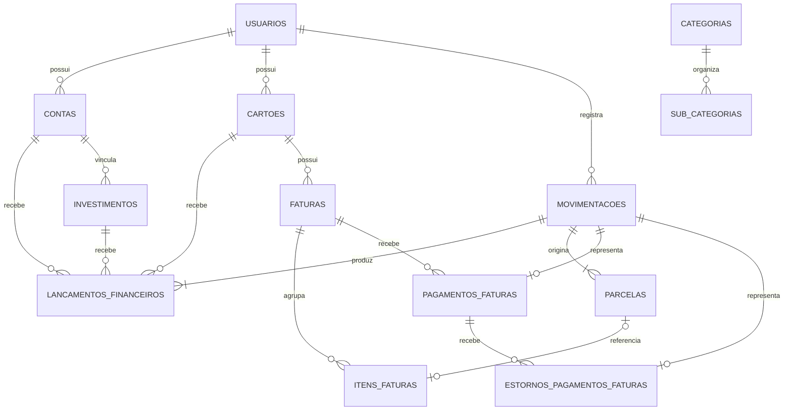

# ERD — Modelo de Dados do Sistema Financeiro

**Versão:** 1.0
**Status:** Proposta conceitual e lógica para validação
**Alinhamento:** PRD v1.0 e Architecture v1.0

> Este documento representa o modelo conceitual e lógico inicial. Não é uma migration pronta nem autorização para implementação.

## 1. Convenções

- Tabelas e colunas em português, `snake_case`.
- PK: `BIGINT GENERATED ALWAYS AS IDENTITY`.
- FKs: `BIGINT`.
- Não utilizar UUID para PK/FK.
- Monetários em `NUMERIC`, com precisão definitiva a validar.
- Valores positivos e natureza/tipo definindo o efeito.
- Datas de calendário em `DATE`.
- Instantes em `TIMESTAMPTZ`.
- `usuario_id` para isolamento multiusuário.
- `situacao CHAR(1)` com códigos documentados e `CHECK`.
- `data_excluido TIMESTAMPTZ NULL` apenas em cadastros aplicáveis.

## 2. Entidades previstas

### Núcleo financeiro
- `usuarios`
- `instituicoes`
- `contas`
- `categorias`
- `sub_categorias`
- `movimentacoes`
- `lancamentos_financeiros`

### Cartões
- `cartoes`
- `faturas`
- `parcelas`
- `itens_faturas`
- `pagamentos_faturas`
- `estornos_pagamentos_faturas`

### Investimentos
- `investimentos`
- Histórico de taxas.
- Histórico de avaliações.
- Movimentações de aportes, resgates e rendimentos.

### Planejamento
- Recorrências.
- Previsões.
- Orçamentos.
- Metas.

## 3. Diagrama conceitual

O diagrama é conceitual. As FKs compostas para isolamento de usuário deverão ser detalhadas no modelo físico.

## 4. Núcleo financeiro

### 4.1 `movimentacoes`

Representa o evento de negócio.

Campos conceituais:
- `id`
- `usuario_id`
- `tipo`
- `descricao`
- `valor_total`
- `moeda`
- `data_competencia`
- `data_efetivacao`
- `situacao`
- `categoria_id` (opcional)
- `sub_categoria_id` (opcional)
- `movimentacao_origem_id` (opcional)
- `data_criacao`

Uma movimentação pode gerar vários lançamentos financeiros.

Exemplos:
- Receita.
- Despesa.
- Transferência.
- Ajuste.
- Compra.
- Pagamento.
- Estorno.
- Compensação.

### 4.2 `lancamentos_financeiros`

Representa os efeitos financeiros concretos.

Campos conceituais:
- `id`
- `usuario_id`
- `movimentacao_id`
- `conta_id` (opcional)
- `investimento_id` (opcional)
- `cartao_id` (opcional)
- `natureza`
- `valor`
- `moeda`
- `data_efetivacao`
- `data_criacao`

Cada lançamento deve apontar para exatamente um destino financeiro válido:

1. Conta: somente `conta_id`.
2. Investimento: `conta_id` e `investimento_id`, obrigatoriamente correspondentes.
3. Cartão: somente `cartao_id`.

A associação entre investimento e conta deverá ser garantida por FK composta.

A coerência do `usuario_id` também deverá ser garantida.

### 4.3 `contas`

Representa contas bancárias e dinheiro disponível.

Uma conta pode possuir vários investimentos e vários cartões associados cadastralmente.

### 4.4 `categorias` e `sub_categorias`

São entidades separadas.

- Uma categoria pode possuir várias subcategorias.
- Cada subcategoria pertence obrigatoriamente a uma categoria.
- Uma movimentação pode ter categoria sem subcategoria.

## 5. Cartões

### 5.1 `cartoes`

Campos conceituais:
- `id`
- `usuario_id`
- `conta_id` (NULL permitido)
- `instituicao_id` (quando aplicável)
- `nome`
- `dia_fechamento`
- `dia_vencimento`
- `limite` (opcional)
- `situacao`
- `data_criacao`
- `data_excluido` (quando aplicável)

Cartões são entidades próprias, não contas bancárias fictícias.

`conta_id` é opcional e não define a conta usada no pagamento da fatura.

### 5.2 `faturas`

Campos:
- `id`
- `usuario_id`
- `cartao_id`
- `data_inicio`
- `data_fechamento`
- `data_vencimento`
- `situacao`
- `data_criacao`

Relacionamento:
- Um cartão possui várias faturas.
- Cada fatura pertence a um cartão.

As datas ficam armazenadas na própria fatura para preservar o histórico.

A fatura é um agrupador de cobrança, não uma nova obrigação financeira.

**Regra de fechamento aprovada:**
- Compras até o dia anterior ao fechamento entram no ciclo que fecha.
- Compras no próprio dia entram no ciclo seguinte.

A data da compra e, quando disponível, a data de processamento devem ser preservadas.

Estados candidatos:
- Aberta.
- Fechada.
- Parcialmente paga.
- Paga.
- Vencida.

Ainda será definido se parcialmente paga e vencida serão estados ou condições derivadas.

### 5.3 `parcelas`

Campos:
- `id`
- `usuario_id`
- `movimentacao_id`
- `numero_parcela`
- `quantidade_parcelas`
- `valor`
- `data_vencimento_prevista`
- `situacao`
- `data_criacao`

Relacionamento:
- Uma movimentação origina uma ou várias parcelas.
- Cada parcela pertence a uma única movimentação.
- Cada parcela pode estar vinculada a no máximo um item de fatura.

Compra à vista gera uma parcela (1/1).

Compra parcelada gera N parcelas.

A soma das parcelas deve corresponder ao valor total da movimentação de compra.

Parcelas originais são preservadas mesmo em cancelamentos e devoluções.

### 5.4 `itens_faturas`

Campos:
- `id`
- `usuario_id`
- `fatura_id`
- `parcela_id` (NULL permitido)
- `tipo`
- `natureza`
- `descricao`
- `valor`
- `data_criacao`

Relacionamentos:
- Uma fatura possui vários itens.
- Um item pertence a uma fatura.
- Um item pode referenciar uma parcela ou representar um componente independente.
- Uma parcela pode aparecer em no máximo um item de fatura.

Tipos possíveis:
- Parcela de compra.
- Juros.
- Multa.
- Anuidade.
- Tarifa.
- Desconto.
- Crédito.
- Ajuste.

O valor será sempre positivo.

A natureza determinará se o item aumenta ou reduz a cobrança.

Itens que referenciam parcelas não podem repetir obrigações já reconhecidas no momento da compra.

Encargos e créditos que alterem a obrigação deverão gerar efeito no livro-razão exatamente uma vez.

## 6. Pagamentos e estornos

### 6.1 `pagamentos_faturas`

Campos:
- `id`
- `usuario_id`
- `fatura_id`
- `movimentacao_id`
- `valor`
- `data_pagamento`
- `situacao`
- `data_criacao`

Relacionamentos:
- Uma fatura possui vários pagamentos.
- Cada pagamento pertence a uma única fatura.
- Cada pagamento corresponde a exatamente uma movimentação.
- Cada movimentação de pagamento corresponde a um único registro em `pagamentos_faturas`.

Uma restrição `UNIQUE(movimentacao_id)` garante a relação 1:1 com a movimentação.

Não armazenar `conta_id` nessa tabela.

A conta pagadora é identificada pelos lançamentos financeiros da movimentação.

Pagamento parcial é permitido.

O pagamento reduz a conta e a obrigação do cartão, sem gerar nova despesa.

### 6.2 `estornos_pagamentos_faturas`

Campos:
- `id`
- `usuario_id`
- `pagamento_fatura_id`
- `movimentacao_id`
- `valor`
- `data_estorno`
- `motivo`
- `data_criacao`

Relacionamentos:
- Um pagamento pode possuir vários estornos.
- Cada estorno pertence a um pagamento.
- Cada estorno corresponde a uma movimentação própria.

Uma restrição `UNIQUE(movimentacao_id)` garante que uma movimentação não represente mais de um estorno.

A soma dos estornos efetivados não pode exceder o valor efetivamente pago.

Essa regra exige validação transacional e proteção contra concorrência no PostgreSQL.

O estorno produz lançamentos inversos ao pagamento.

O pagamento original e os estornos efetivados permanecem imutáveis.

## 7. Cancelamentos e devoluções

Regras aprovadas:
- Cancelamentos e devoluções são compensações vinculadas à compra original.
- Compra e parcelas originais permanecem preservadas.
- Parcelas futuras ainda não faturadas são compensadas da última para a primeira.
- Excedentes seguem o crédito real concedido pela operadora ou o reembolso recebido.
- Parcelas faturadas e não pagas podem receber créditos nas faturas.
- Parcelas já pagas são tratadas por crédito futuro ou entrada em conta, conforme o destino real.
- Uma compensação não pode reduzir a obrigação duas vezes.

O modelo físico precisa rastrear:
- Operação de cancelamento/devolução.
- Compra original.
- Parcelas afetadas.
- Valores compensados por parcela.
- Itens de crédito nas faturas.
- Movimentações e lançamentos correspondentes.

**Proposta pendente de validação:** criar uma entidade para o evento de cancelamento/devolução e outra para alocação dos valores compensados por parcela, com nome candidato `compensacoes_parcelas`.

A estrutura final depende da definição de como representar créditos excedentes e reembolsos em conta.

## 8. Exemplos de operações

### Compra de R$ 1.200 em 12 vezes
- Uma movimentação de despesa por R$ 1.200.
- Doze registros em `parcelas`, cada um com R$ 100.
- Obrigação total reconhecida no cartão no momento da compra.
- Cada parcela entra no item da fatura correspondente, sem duplicar a obrigação.

### Compra à vista de R$ 300
- Uma movimentação por R$ 300.
- Uma parcela 1/1 de R$ 300.
- Um item de fatura quando cobrada.

### Pagamento parcial de R$ 600 em fatura de R$ 1.000
- Uma movimentação de pagamento.
- Um registro em `pagamentos_faturas` de R$ 600.
- Saída na conta pagadora.
- Redução da obrigação no cartão.
- Saldo aberto de R$ 400, antes de encargos e estornos.

### Estorno de pagamento de R$ 600
- Pagamento original preservado.
- Um registro em `estornos_pagamentos_faturas`.
- Uma movimentação de estorno.
- Entrada na conta.
- Recomposição da obrigação no cartão.

## 9. Constraints e índices candidatos

### Constraints

- FKs compostas para isolamento por usuário.
- FK composta para correspondência entre investimento e conta.
- `UNIQUE(parcela_id)` em `itens_faturas`.
- `UNIQUE(movimentacao_id)` em `pagamentos_faturas`.
- `UNIQUE(movimentacao_id)` em `estornos_pagamentos_faturas`.
- `CHECK(valor > 0)` em itens, pagamentos e estornos.
- `CHECK` para domínios de tipo, natureza e situação.
- Validação de dias de fechamento e vencimento.
- Limite acumulado de estornos validado transacionalmente.
- Soma das parcelas validada antes da efetivação da compra.

### Índices candidatos

- FKs utilizadas em joins.
- `(usuario_id, cartao_id, data_vencimento)` em faturas.
- `(usuario_id, fatura_id)` em itens e pagamentos.
- `(usuario_id, movimentacao_id)` em parcelas e lançamentos.
- `(usuario_id, pagamento_fatura_id)` em estornos.

Os índices definitivos serão decididos com base nos padrões de consulta e volume esperado, usando `EXPLAIN (ANALYZE, BUFFERS)` para validação.

## 10. Pendências para fechar o ERD

1. Modelo físico de cancelamentos/devoluções e alocação por parcela.
2. Vínculo explícito entre item de fatura e movimentação/lançamento de encargos e créditos.
3. Cálculo do total e saldo da fatura sem fontes duplicadas.
4. Estados e transições de faturas, parcelas, pagamentos, estornos e itens.
5. Compras processadas com atraso e calendário de fechamento para dias 29, 30 e 31.
6. Algoritmo de distribuição de centavos.
7. Domínios finais de `tipo`, `natureza` e `situacao`.
8. Constraints compostas completas de isolamento por usuário.
9. Precisão `NUMERIC` definitiva por domínio e moeda.

## 11. Status

Este documento é uma proposta para validação.

Não representa autorização para migrations ou implementação.

Após validação, as decisões aprovadas serão consolidadas e as pendências resolvidas antes do início da implementação do modelo físico.